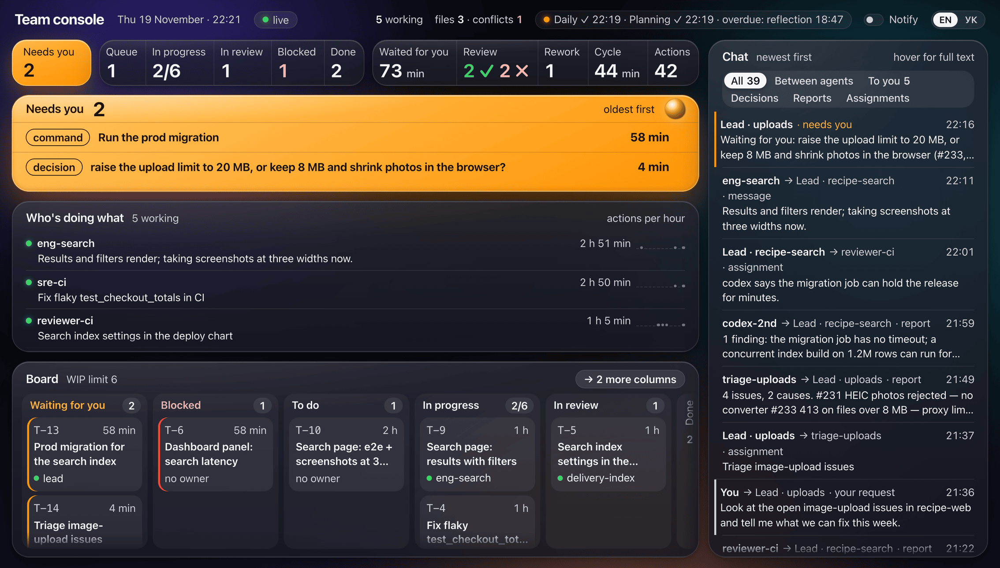
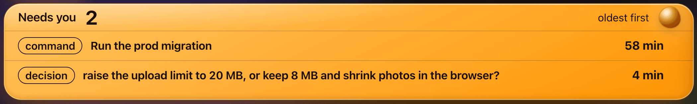
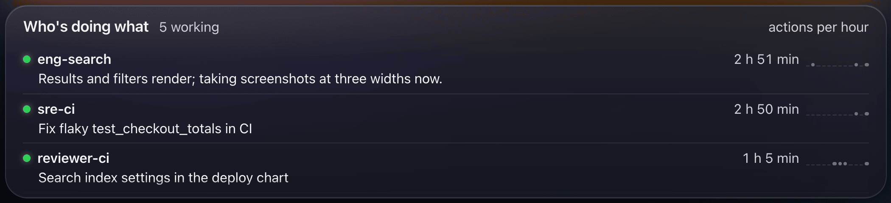
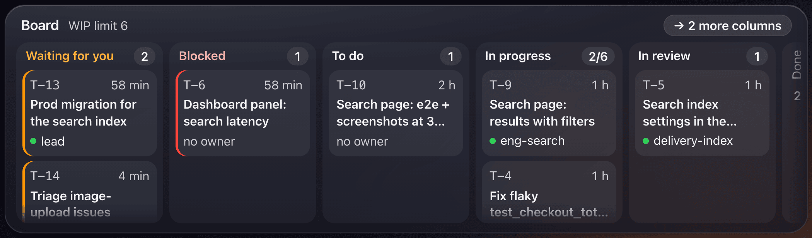
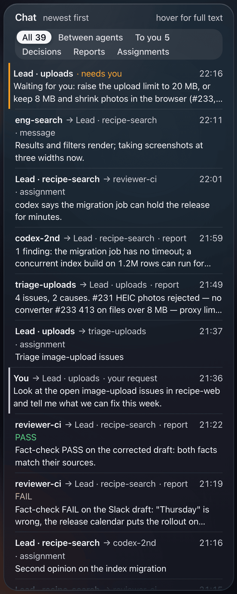
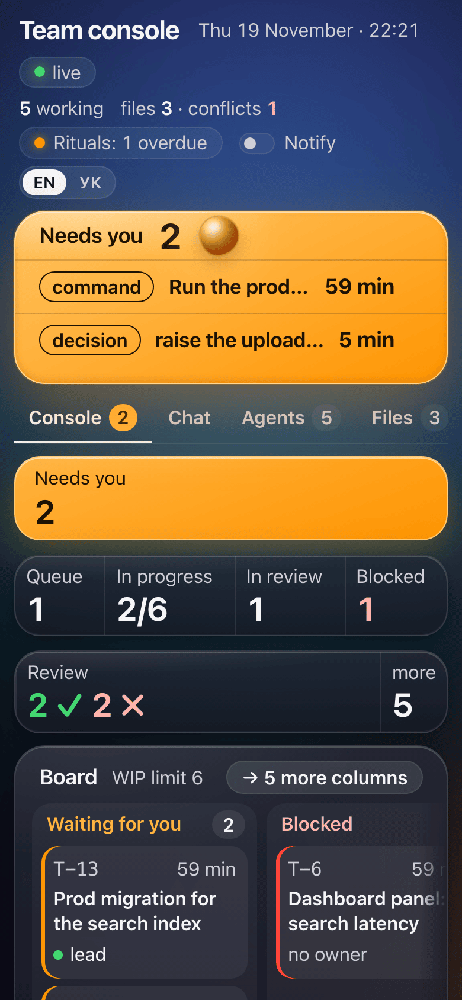

# Claude team harness

A local harness that runs a Claude Code session as a team lead with specialist subagents, and shows what the team does on a dashboard in your browser.



## What you get

- A "Needs you" zone: when the lead ends a reply with a "What I need from you" block, or a card waits for your answer, the item stays at the top of the dashboard until you answer it.

  
- Who works on what: each running agent with its latest status line and how long it has run.

  
- A task board: cards `T-n` with status, owner role and model/effort. An Agent call whose description starts with `T-12: ...` attaches to that card. A finished card goes to review, and only the lead moves it to done.

  
- Team chat: agents post asks, answers, decisions, blockers, handoffs and reports with `team.py`, and a message to an agent reaches it on its next tool call. Reviewer verdicts show as PASS or FAIL.

  
- File claims: an edit claims the file for that agent. Another agent's edit of the same file is denied, and so are `git checkout`, `stash`, `reset --hard` and similar commands in a worktree where someone else has edits.
- A fact-check gate for outward text: Slack, Jira, Confluence and `gh` writes that hold dates, numbers, versions or ticket refs are blocked until a reviewer or Codex agent that did not write the text records a PASS with a primary source for each fact.
- Rituals: skills for a daily, weekly planning, a retro and an evening reflection, optionally run by launchd. The lessons they write are injected into every later run of that role.

The dashboard also works at phone width:



The same board in the terminal (`python3 .claude/team/team.py board`):

```
== To do (1)
  T-10   Search page: e2e + screenshots at 3 viewports  [-] #recipe-search  3h00m
== In progress (2)
  T-4    Fix flaky test_checkout_totals in CI  [sre-ci opus/high] #flaky-ci  84m — per-worker test databases approved
  T-9    Search page: results with filters  [eng-search opus/high] #recipe-search  1h52m
== In review (1)
  T-5    Search index settings in the deploy chart  [delivery-index sonnet/high] #recipe-search  68m
== Blocked (1)
  T-6    Dashboard panel: search latency  [-] #recipe-search  59m — needs search metrics from T-8 on staging
== Waiting for you (2)
  T-13   Prod migration for the search index  [lead] #recipe-search  59m — Run the prod migration: `! make -C ~/work/recipe-api migrate-prod`
  T-14   Triage image-upload issues  [triage-uploads sonnet/medium] #uploads  5m — Product: raise the upload limit to 20 MB, or keep 8 MB and shrink photos in the…
```

All pictures use the invented demo data of `.claude/team/dashboard/seed_demo.py`.

## How it works

```
Claude Code hooks ──> .claude/team/hook.py ──> state/team.db (SQLite)
                                                   │
          team.py (CLI: board, chat, factcheck) ───┤
                                                   └──> dashboard/server.py ──> http://127.0.0.1:7777
```

Hooks write every spawn, tool call, message, file edit and finish into a SQLite event log. The board, the chat, the file claims and the fact-check gate all read and write that log, and the dashboard reads it. Each subagent gets the team protocol, a snapshot of the team and its role's lessons when it starts. The log and the dashboard stay on your machine; the dashboard listens on 127.0.0.1 only. Details are in [How it works in detail](#how-it-works-in-detail).

## Quick start

1. Clone this repository.
2. Give your coding agent the prompt in [Install with an agent](#install-with-an-agent), or follow the manual [Install](#install) steps.
3. Start `claude` in the workspace. The session brief prints the dashboard URL.
4. Give the lead a task. Open the URL to watch the team work on it.

## Install with an agent

Start your coding agent (Claude Code or a similar CLI agent) in the workspace you want to equip and give it this prompt. Replace the path with the absolute path of where you cloned this repository (a `git clone`, not a zip).

```
Install the Claude team harness, cloned at <absolute path to this clone>, into the workspace in the current directory. Follow the "Install with an agent" section of its README.md: run every step and its check, and show me the output. Stop and ask before overwriting or modifying any existing file, and before running any launchd or sudo script. Do not touch ~/.claude. At the end, list what you changed and what is left for me.
```

Run from the workspace root. Shell state may not carry over between commands, so each command sets what it needs. `grep -c` exits 1 when it prints `0`; that is not a failure when `0` is the expected answer.

1. Prerequisites: `python3 --version` prints 3.9 or newer, `claude --version` prints a version, `git` and `lsof` exist. Port: if `.claude/settings.json` already sets `TEAM_PORT`, use that value. Otherwise `lsof -nP -iTCP:7777 -sTCP:LISTEN` prints nothing; if it prints a line, pick a free port and put `TEAM_PORT=<port>` directly in front of each `python3` below. If `.claude/team/state/team.db` already exists, skip step 4, the `task add` part of step 5 and step 6: they write test rows into the real event log.
2. Snapshot, the only way back, into the sibling directory `../<workspace name>.claude-team-before` (`-before` below). If it exists, stop and ask the human whether it is the snapshot of an earlier run of this install; if so, keep it and go to step 3, otherwise stop: the human decides what happens to it. If it does not exist (in a subdirectory of a repository it sits inside that work tree; `-after` below is `../<workspace name>.claude-team-after`): `s="../$(basename "$(pwd -P)").claude-team-before"; mkdir "$s" && { ok=1; for f in .claude CLAUDE.md .gitignore; do if [ -e "$f" ] || [ -L "$f" ]; then cp -Rp "$f" "$s"/ || ok=0; fi; done; if [ $ok = 1 ] && touch "$s/.complete"; then ls -A "$s"; else echo "snapshot incomplete"; false; fi; }`. The list shows what exists now, plus `.complete`; what is missing from it did not exist. On `snapshot incomplete` (a copy failed, for example a file you cannot read) tell the human: the directory is theirs to delete before a new try, and nothing may be installed.
3. Install. It refuses, before writing anything, if the workspace is `~` or `~/.claude`, if there is no complete snapshot, if a path it writes or a parent of it is a symlink, if a `<file>.part` is in the way, if `settings.json` is not a JSON object of the expected shape, if `TEAM_PORT` differs from the one in `settings.json`, or if the path is not the root of a git clone of this repository. Otherwise it copies the clone's tracked `.claude` files without overwriting yours, adds the hooks and the agent-teams `env` key to `settings.json` (plus `TEAM_PORT` if you set it), appends `CLAUDE.example.md` to `CLAUDE.md` and, inside a git work tree, whichever of three lines are missing to `.gitignore`. Every write goes through a `.part` file. A re-run adds only what is missing.
```
H='<absolute path to the clone>' python3 - <<'EOF'
import json,os,sys,subprocess,shutil
H=os.environ['H']; GI='.claude/team/state/\n.claude/team/rituals/\n.claude/backup/\n'; real=os.path.realpath; p='.claude/settings.json'
def die(m): sys.exit('refusing: '+m)
def rd(p): return open(p,newline='',encoding='utf-8').read() if os.path.exists(p) else None
def put(p,t,m='w'):
    t=(rd(p) or '')+t if m=='a' else t; open(p+'.part','w',newline='',encoding='utf-8').write(t)
    if os.path.exists(p): shutil.copymode(p,p+'.part')
    os.replace(p+'.part',p)
def lk(p): return any(os.path.islink('/'.join(p.split('/')[:i])) for i in range(1,len(p.split('/'))+1))
def git(*a): return subprocess.run(['git']+list(a),capture_output=True,text=True).stdout
cwd=real('.'); cfgs=[real(os.path.expanduser(c)) for c in ('~/.claude',os.environ.get('CLAUDE_CONFIG_DIR') or '~/.claude')]
if cwd==real(os.path.expanduser('~')) or real('.claude') in cfgs or any(cwd==c or cwd.startswith(c+os.sep) for c in cfgs): die('the workspace is the home directory or the user-global config')
T=git('-C',H,'ls-files','-z','.claude').split('\0')[:-1]
if not os.path.isabs(H) or real(git('-C',H,'rev-parse','--show-toplevel').strip() or '/none')!=real(H) or '.claude/team/hook.py' not in T: die('H must be the absolute path of a git clone of the harness')
s=os.path.join(os.path.dirname(cwd),os.path.basename(cwd)+'.claude-team-before')
if not os.path.isfile(s+'/.complete'): die('no complete snapshot at '+s+'; make it in step 2')
bad=[f for f in ['CLAUDE.md','.gitignore',p]+T if lk(f) or os.path.lexists(f+'.part')]
if bad: die('symlinks or leftover .part files (roll back and start again): '+', '.join(bad))
try:
    cur=json.loads(rd(p) or '{}'); ex=json.loads(rd(H+'/.claude/settings.example.json')); md=rd(H+'/CLAUDE.example.md'); old_md=rd('CLAUDE.md') or ''; old_gi=rd('.gitignore') or ''
    new={f:rd(H+'/'+f) for f in T if not os.path.exists(f)}; [rd(f) for f in T]
    if None in new.values(): die('the clone is missing tracked files, run git status there')
    for f in T:
        d=os.path.dirname(f)
        while d:
            if os.path.exists(d) and not os.path.isdir(d): die(d+' is a file')
            d=os.path.dirname(d)
except (ValueError,TypeError,OSError) as e: die('cannot read '+str(e)[:200])
ok=lambda c: isinstance(c,dict) and isinstance(c.get('env',{}),dict) and isinstance(c.get('hooks',{}),dict) and all(isinstance(v,list) and all(isinstance(y,dict) and isinstance(y.get('hooks',[]),list) and all(isinstance(h,dict) for h in y.get('hooks',[])) for y in v) for v in c.get('hooks',{}).values())
if not ok(cur) or not md: die(p+' must be a JSON object with "env" an object and "hooks" an object of lists of entries')
port=os.environ.get('TEAM_PORT'); env=cur.get('env',{})
if port and str(env.get('TEAM_PORT',port))!=port: die('settings.json sets TEAM_PORT='+str(env['TEAM_PORT'])+'; use that port or ask the human')
before=json.dumps(cur); want=dict(ex['env'],**({'TEAM_PORT':port} if port else {})); env=cur.setdefault('env',{}); added=[k for k in want if k not in env]
for k in added: env[k]=want[k]
for e,es in ex['hooks'].items():
    a=cur.setdefault('hooks',{}).setdefault(e,[])
    for x in es:
        if not any(y.get('matcher')==x.get('matcher') and all(h['command'] in [z.get('command') for z in y.get('hooks',[])] for h in x['hooks']) for y in a): a.append(x)
try: out=json.dumps(cur,indent=2,ensure_ascii=False)+'\n'; out.encode('utf-8')
except ValueError as e: die('settings.json has text that cannot be written as UTF-8')
for f in T:
    if f in new:
        os.makedirs(os.path.dirname(f),exist_ok=True); shutil.copy(H+'/'+f,f+'.part'); os.replace(f+'.part',f)
    elif rd(f)!=rd(H+'/'+f): print('kept yours, merge by hand:',f)
if json.dumps(cur)!=before: put(p,out)
if md in old_md: pass
elif '# Team lead mode' in old_md.splitlines(): print('kept yours, merge by hand: CLAUDE.md')
else: put('CLAUDE.md',('\n' if old_md else '')+md,'a')
if git('rev-parse','--is-inside-work-tree').strip()=='true':
    m=''.join(l+'\n' for l in GI.split() if l not in [x.strip() for x in old_gi.splitlines()])
    if m: put('.gitignore',('\n' if old_gi else '')+m,'a')
print('env keys added:',added)
EOF
```
   Checks: no `kept yours` line (each one is a file of yours that differs from the clone's, or a `CLAUDE.md` that has the heading but not the block; nothing was overwritten); `grep -c team/hook.py .claude/settings.json` prints `8` (more if you already had hooks that call it); `grep -c '^# Team lead mode' CLAUDE.md` prints `1`; in a git work tree `git check-ignore .claude/team/state/team.db .claude/team/rituals/x .claude/backup/x` prints all three paths. If `CLAUDE_CODE_EXPERIMENTAL_AGENT_TEAMS` is not in `env keys added`, your settings already set it: tell the human to check it is `1`. An existing `settings.json` is rewritten with 2-space indentation, content kept.
4. Hook smoke test: `echo '{"session_id":"t","hook_event_name":"SessionStart","source":"startup"}' | CLAUDE_PROJECT_DIR="$PWD" python3 .claude/team/hook.py`. Check: the JSON contains `Team harness on.` It creates `.claude/team/state/team.db` and starts the dashboard.
5. Log, board, dashboard: `python3 .claude/team/team.py feed --all` prints a line ending `lead session: startup`. `python3 .claude/team/team.py task add "smoke test" --owner lead` prints the new id (`T-<n>`); `python3 .claude/team/team.py board` shows it under `To do`; `python3 .claude/team/team.py task drop T-<n>` prints `ok`. `python3 .claude/team/team.py dashboard start` prints `running http://` (or `started http://`); `failed: ... held by another program` means the port is taken, so go back to step 1.
6. Gate: `n=$(mktemp) && echo 'Fixed in v1.2.3' > "$n" && printf '{"session_id":"t","hook_event_name":"PreToolUse","tool_name":"Bash","tool_input":{"command":"gh pr comment 5 --body-file %s"}}' "$n" | CLAUDE_PROJECT_DIR="$PWD" python3 .claude/team/hook.py; rm "$n"` prints a `permissionDecision` of `deny` that names the version.

Steps that stay with the human:

- The human starts a new `claude` in the workspace and approves any trust prompt, so the SessionStart hook runs for real. Then `team.py feed --all` has a new `lead session: startup` line after the smoke test's.
- Rituals: `.claude/team/schedule/install.sh` (macOS) registers four launchd jobs that run `claude -p` unattended with `--permission-mode auto`. Caps per run: daily $3, planning $5, retro $6, reflect $6. Daily and reflect run on 5 weekdays, planning and retro once a week, so the worst case is 5x3 + 5 + 6 + 5x6 = $56 a week. The labels `com.claude-team.*` are per user, not per workspace: installing from a second workspace replaces the first one's jobs, and `uninstall.sh` removes them. Check: `launchctl list | grep com.claude-team` lists four labels. `claude --help` must show `--effort`, `--permission-mode` and `--max-budget-usd`.
- Local domain: `sudo .claude/team/schedule/install-domain.sh` edits `/etc/hosts`, `pf` and a LaunchDaemon. See "Local domain". Accounts: the Codex CLI, `gh` and the Slack and Jira connectors are the human's; replace the example MCP tool ids in `researcher.md`.

Roll back, only on the human's yes. It restores the snapshot of `.claude`, `CLAUDE.md` and `.gitignore`, so it discards every change made to those three since step 2, harness or not. If the install stopped midway or refused because of a leftover `.part` file, roll back and start again from step 1; a finished rollback leaves `-before` and `-after`, so ask the human to delete or move both before the new snapshot. In order:

1. If the human installed the schedule or the local domain, ask them to run `.claude/team/schedule/uninstall.sh` and `sudo .claude/team/schedule/uninstall-domain.sh` first; do not run them yourself.
2. Show the human what would be discarded: `s="../$(basename "$(pwd -P)").claude-team-before"; nd=; diff --no-dereference /dev/null /dev/null 2>/dev/null && nd=--no-dereference; for f in .claude CLAUDE.md .gitignore CLAUDE.md.part .gitignore.part; do if [ -e "$s/$f" ] || [ -e "$f" ]; then diff -rqN $nd "$s/$f" "$f"; fi; done` lists every file that differs, and `diff -rN $nd` instead of `diff -rqN $nd` shows the contents. `$nd` is `--no-dereference` when this `diff` supports it; without it a dangling symlink inside `.claude` makes the compare print an error that is not a difference. Tell the human to copy out anything they want to keep, then ask for a yes. No snapshot directory means no rollback: say so and stop.
3. On the yes, run this. It stops the workspace's dashboard, copies the snapshot aside, moves the current files into `-after` and swaps the copies in, deleting nothing. If it was interrupted (the shell died, no `refusing` line), run it again: it resumes. If it prints any `refusing` line (`-after` exists or is a symlink, a name is back in the workspace, copy failed, no complete snapshot, the dashboard still runs), do not run it again and never delete `-after`: stop and ask the human. A `restoring` or `restoring.<pid>` directory in `-after` is left by an interrupted run (a kill at the very end can leave it empty); ignore it.
```
bash <<'EOF'
s="../$(basename "$(pwd -P)").claude-team-before"; m="../$(basename "$(pwd -P)").claude-team-after"; t="$m/restoring"
n=".claude CLAUDE.md .gitignore CLAUDE.md.part .gitignore.part"
[ -f "$s/.complete" ] || { echo "refusing: no complete snapshot"; exit 1; }
if [ -L "$m" ] || { [ -e "$m" ] && [ ! -e "$m/.restoring" ] && [ -n "$(ls -A "$m")" ]; }; then echo "refusing: $m exists or is a symlink, never delete it, ask the human"; exit 1; fi
if [ -f .claude/team/team.py ]; then python3 .claude/team/team.py dashboard stop; fi
p=$(cat .claude/team/state/dashboard.pid 2>/dev/null); if [ -n "$p" ] && kill -0 "$p" 2>/dev/null && ps -p "$p" -o command= 2>/dev/null | grep -qF "$(pwd -P)/.claude/team/dashboard/server.py"; then echo "refusing: the dashboard (pid $p) still runs; stop it by hand and run this again"; exit 1; fi
mkdir -p "$m" && touch "$m/.restoring" || exit 1
if [ ! -e "$t" ]; then
  mkdir "$t.$$" || exit 1
  for f in $n; do
    if [ -e "$s/$f" ] || [ -L "$s/$f" ]; then cp -Rp "$s/$f" "$t.$$"/ || { echo "refusing: copy failed"; exit 1; }; fi
  done
  mv "$t.$$" "$t" || exit 1
fi
for f in $n; do
  if [ -e "$t/$f" ] || [ -L "$t/$f" ] || { [ ! -e "$s/$f" ] && [ ! -L "$s/$f" ]; }; then
    if [ -e "$f" ] || [ -L "$f" ]; then
      if [ -e "$m/$f" ] || [ -L "$m/$f" ]; then echo "refusing: $f is back in the workspace and $m/$f exists, ask the human"; exit 1; fi
      mv "$f" "$m"/ || exit 1
    fi
    if [ -e "$t/$f" ] || [ -L "$t/$f" ]; then mv "$t/$f" . || exit 1; fi
  fi
done
rm "$m/.restoring" && rmdir "$t"
EOF
```
4. Check: the compare command from item 2 prints nothing. Tell the human to restart any `claude` session started in the workspace after the install, and that the `-before` and `-after` directories are theirs to delete (in a subdirectory of a repository they show up there as untracked directories).

## How it works in detail

Everything is in English by default. The dashboard also has Ukrainian: it follows the browser
language, an EN / УК toggle in the header switches it (the choice is saved), and `?lang=en|uk` in the
URL overrides both. `TEAM_LANG=uk` switches the CLI board headings and the event texts that hooks
write. The hook that turns the lead's "What I need from you" block into a "Needs you" item also
recognises the Ukrainian heading "Що від тебе"; see `CLAUDE.example.md`.

```
Claude Code hooks ──> .claude/team/hook.py ──> state/team.db (SQLite, WAL)
                                                   │
          team.py (CLI: board, chat, factcheck) ───┤
                                                   └──> dashboard/server.py ──> http://127.0.0.1:7777
                                                                         (or http://mission.control, see below)
launchd ──> schedule/run-ritual.sh ──> claude -p "/daily" | "/planning" | "/retro" | "/reflect"
```

- `hook.py` handles `SessionStart`, `UserPromptSubmit`, `PreToolUse`, `SubagentStart`,
  `SubagentStop`, `Stop`, `SessionEnd` and `Notification`. It logs events, links each subagent to
  its spawn and board card, injects `PROTOCOL.md`, a team snapshot and role lessons into every
  subagent, and delivers team chat addressed to an agent on its next tool call.
- Board: cards `T-n` with status, owner role and model/effort. An Agent call whose description
  starts with `T-12: ...` attaches to that card; an untagged spawn opens its own card. A finished
  worker's card moves to review; only the lead moves it to done.
- File claims: every Edit/Write claims the file for that agent. Another agent's edit of the same
  file is denied, and so are `git checkout/switch/stash/reset --hard/rebase/pull/merge/clean/restore`
  in a worktree where someone else has edits.
- Fact-check gate: Slack, Jira and Confluence write tools (matched by tool name, any MCP server
  prefix) and `gh pr|issue|release` writes and `gh api` writes are denied while their text holds
  dates, weekdays, times, numbers, versions, ticket/PR refs or cron expressions with no PASS for that
  exact text in the last 24 hours. A `reviewer` or `codex` agent that did not write the text
  records the PASS with one primary source per fact (`team.py factcheck pass`). It also checks that
  weekdays match dates and that a "first run" date is the schedule's real first firing.
- Dashboard: `dashboard/server.py` listens on 127.0.0.1 only and accepts only its own host names.
  Every `GET` endpoint reads the database without writing to it. The one write endpoint is
  `POST /api/focus` (same-origin, an `X-Team-Action: focus` header, at most one call per second): it
  runs `osascript` to bring the Apple Terminal tab of a lead session to the front, for the "Go" button
  on a "Needs you" item. The `SessionStart` hook starts the server if the port is free and prints its
  URL. There is no authentication: any local process or user on the machine can read the board and
  chat over loopback, so do not run it on a shared machine.
- Rituals: skills `daily`, `planning`, `retro` and `reflect`. `schedule/install.sh` registers
  launchd jobs (macOS) that run them headless with `claude -p`. Notes land in
  `.claude/team/rituals/<kind>/<date>.md`.
- Knowledge base: `.claude/knowledge/` starts empty. The team adds one entry per solved problem
  while working and in `reflect`/`retro`; `python3 .claude/skills/kb/kb.py` validates the entries and
  regenerates `INDEX.md`, and agents read the index before they start (skill `kb`).
- STE check (optional, off by default): the hook passes each Agent brief, SendMessage text and
  team chat post to an STE linter that you supply, and adds its findings as an `ste:` note to the
  agent's next context. See [STE check](#ste-check-optional).

## Layout

```
CLAUDE.example.md            lead instructions to merge into your CLAUDE.md
.claude/settings.example.json  hooks wiring to merge into .claude/settings.json
.claude/team/                hook.py, team.py, teamlib.py, PROTOCOL.md, lessons/, schedule/, dashboard/, tests/
.claude/agents/              role templates: software-engineer, delivery-engineer, platform-sre,
                             product-designer, researcher, reviewer, codex
.claude/skills/              daily, planning, retro, reflect, humanize, kb
.claude/knowledge/           the knowledge base (README.md and a generated INDEX.md)
docs/screenshots/            the pictures in this README, made from the demo data
```

## Requirements

- Claude Code with hooks and subagents; `settings.example.json` turns on agent teams
  (`CLAUDE_CODE_EXPERIMENTAL_AGENT_TEAMS=1`).
- Python 3.9 or newer, standard library only (SQLite with JSON functions, as shipped with Python).
- macOS for the launchd rituals, the local domain and the dashboard's "Go" button (Apple Terminal
  via `osascript`); the rest runs anywhere Python does. `lsof` for `team.py dashboard stop`.
- The rituals call the Claude Code CLI as `claude -p "/<skill>" --model <m> --effort <e>
  --permission-mode auto --max-budget-usd <n>`; check that your `claude` version accepts these flags.
- Optional: the Codex CLI for the `codex` agent; Slack, Jira and GitHub (`gh`) connectors for the
  researcher and the fact-check gate to have something to guard. `agents/researcher.md` lists Slack
  and Atlassian MCP tool ids as an example; change them to the connectors you actually have.

## Install

1. Copy `.claude/` into your workspace root (the directory you start `claude` in), so you get
   `<workspace>/.claude/team/`, `.claude/agents/`, `.claude/skills/` and `.claude/knowledge/`.
2. Merge `.claude/settings.example.json` into `<workspace>/.claude/settings.json`. The hook command
   uses `$CLAUDE_PROJECT_DIR`, so no paths need editing.
3. Append `CLAUDE.example.md` to `<workspace>/CLAUDE.md` and adjust the model table and reporting
   language to taste.
4. Add these to your workspace `.gitignore`: `.claude/team/state/`, `.claude/team/rituals/` and
   `.claude/backup/`. The event log stores prompts, agent briefs and drafts.
5. Start `claude` in the workspace. The session brief prints the dashboard URL and the CLI path.
6. Optional rituals: `.claude/team/schedule/install.sh` (uninstall with `uninstall.sh`).
   `RITUAL_MODEL` sets the model for planning, retro and reflect (default `opus`); `CLAUDE_BIN`
   points at `claude` if it is not on the login shell's `PATH`; `TEAM_LANG` picks the hook language.
   When set at install time, `CLAUDE_BIN`, `RITUAL_MODEL` and `TEAM_LANG` are written into each
   launchd job's `EnvironmentVariables`.

Paths are derived from the files' own location. Environment overrides:

| Variable | Default | Meaning |
|---|---|---|
| `TEAM_DB` | `.claude/team/state/team.db` | event log and board |
| `TEAM_RITUALS` | `.claude/team/rituals` | ritual notes |
| `TEAM_PORT` | `7777` | dashboard port (set it in the settings `env` so hooks see it too) |
| `TEAM_BACKEND_PORT` | `TEAM_PORT` + 1 | `install-domain.sh` only: the port the local-domain redirect points at; the dashboard reads it from the anchor file |
| `TEAM_WORKSPACE` | two levels above `.claude/team` | workspace root, used to find this workspace's transcripts in `~/.claude/projects/<slug>` |
| `CLAUDE_CONFIG_DIR` | `~/.claude` | Claude Code config dir |
| `TEAM_AS` | `lead` | default `--as` for the CLI |
| `TEAM_LANG` | `en` | `uk` for Ukrainian CLI board headings and hook event texts; without it the value comes from `.claude/team/config.json` (`{"lang": "uk"}`), which also reaches the CLI run from a plain terminal |
| `TEAM_CONFIG` | `.claude/team/config.json` | path of that config file |
| `TEAM_STE` | `off` | STE check mode: `off`, `warn` or `deny`; without it the value comes from the key `ste` in `config.json` |
| `TEAM_STE_DIR` | `.claude/team/ste` | directory of your STE linter and its word lists |

The project slug is the workspace's absolute path with every non-alphanumeric character replaced
by `-`, as Claude Code names its project directories.

## Local domain (optional, macOS)

The dashboard can open at `http://mission.control` instead of `http://127.0.0.1:7777`. Start the
dashboard first (`python3 .claude/team/team.py dashboard start`), then run once, from the workspace
root:

```
sudo .claude/team/schedule/install-domain.sh
curl -sI http://mission.control      # expect HTTP/1.0 200 OK and Server: team-dashboard
```

On the first visit type the address with `http://`. Choosing a name: reserved zones such as `.test`
and `.internal` are the safe choice; `.control` is not reserved, so a real site under that name
would be shadowed on this machine; avoid `.dev`, `.app` and `.page` (browsers force https there) and
`.local` (mDNS on macOS).

What it changes on the machine:

- `lo0`: a loopback alias `127.0.0.77` (`TEAM_ADDR` picks another 127.x address), so port 80 of
  127.0.0.1 stays free for your other local servers. If the alias already exists, the script uses
  it and leaves it in place on uninstall.
- `/etc/hosts`: one line `127.0.0.77 mission.control # claude-team`, written to a temporary file and
  moved into place (a symlinked hosts file is followed to its target). The first run saves a copy of
  the original to `/var/db/claude-team/hosts.bak`.
- `/etc/pf.anchors/claude-team`: a comment naming the owner (`# claude-team port=7777 backend=7778`)
  and `rdr pass on lo0 inet proto tcp from any to 127.0.0.77 port 80 -> 127.0.0.1 port 7778`, loaded
  into the pf sub-anchor `com.apple/claude-team`. The stock `/etc/pf.conf` already evaluates
  `rdr-anchor "com.apple/*"`, so it is not edited.
- `/var/db/claude-team/`: `boot.sh`, its log `boot.log`, the pf enable token (`pf.token`), whether
  the alias is ours, and whether pf was already enabled before the first install. `boot.sh` adds our
  alias, loads the anchor, takes a new enable reference with `pfctl -E`, saves its token and then
  releases the previous one with `pfctl -X <token>`, so re-installs do not pile up references; if
  `pfctl -E` fails it keeps the old token and exits non-zero.
- `/Library/LaunchDaemons/com.claude-team.domain.plist`: runs `boot.sh` at boot and once on install.

The redirect does not point at the dashboard port. Apple's pf also applies an `rdr` rule in reverse
to outgoing packets whose source is the redirect target, so the replies a server sends from that
address and port to a direct client are rewritten to `127.0.0.77:80` and the direct connection
never completes. The target port is therefore reachable only through the redirect, by design. The
server keeps 127.0.0.1:`TEAM_PORT` for direct use and opens a second listener for pf on the backend
port (`TEAM_BACKEND_PORT` given to the installer, default `TEAM_PORT` + 1). It reads the anchor file
every second and opens that listener only when the comment's `port=` is its own `TEAM_PORT`, so a
second workspace's dashboard on another port leaves the domain alone. It closes the listener when
the anchor goes away, and when it cannot bind the port it logs the error once, keeps serving the
main port and retries every 5 seconds. Both listeners accept the domain name in the `Host` header.

Before changing anything the script refuses when another program already listens on the backend
port (the redirect would cut it off from direct connections); pick another with `TEAM_BACKEND_PORT`.
After loading the rule it checks:
- the anchor holds the redirect (`pfctl -a com.apple/claude-team -s nat`) and pf is enabled. Only
  then does it write the hosts line, so a failed upgrade never leaves a new name behind;
- if a server listened on 127.0.0.1:`TEAM_PORT` before the install, direct connections to it still
  work (`ok: 127.0.0.1:7777 still answers direct connections`);
- `http://<name>/` answers with the dashboard's `Server: team-dashboard` header
  (`ok: http://mission.control/ answers with the dashboard`).

If the first or second check fails, the script runs `uninstall-domain.sh`: it removes the boot job
and its plist, releases our pf enable reference, flushes the anchor and deletes its file, removes
the alias if the install added it, takes the marked line out of the hosts file and deletes
`/var/db/claude-team/`. Then it checks that none of these are left, says so, and exits non-zero.
An earlier working install, for example one under another name, is removed as well, and the script
says that the local domain is now uninstalled; the dashboard stays at `http://127.0.0.1:7777`. If
the third check fails, the redirect stays: a dashboard of this version opens the backend listener by
itself within a few seconds, one started on an older version needs a restart
(`team.py dashboard stop`, then `team.py dashboard start`). For a bug report,
`sudo .claude/team/schedule/diag-domain.sh <new file>` writes pf, interface and connection details
to that file without changing anything else; it refuses an existing path or a symlink and gives the
file to the user who ran sudo.

It also warns when `/etc/pf.conf` has no `rdr-anchor "com.apple/*"` line. The session brief and
`team.py dashboard` print `http://mission.control` when the marked hosts line and an anchor owned by
the current `TEAM_PORT` exist, otherwise the 127.0.0.1 URL; `team.py dashboard status` says which of
the two addresses answers, and `stop` only stops this workspace's dashboard. `TEAM_HOST`,
`TEAM_PORT`, `TEAM_BACKEND_PORT` and `TEAM_ADDR` change the name, ports and loopback address. sudo
drops your environment, so pass them after `sudo`:
`sudo TEAM_HOST=board.test TEAM_PORT=7780 .claude/team/schedule/install-domain.sh`. Re-running the
script replaces its own line, rules and alias, including a line for a different name.

A `*.localhost` name (`sudo TEAM_HOST=team.localhost .claude/team/schedule/install-domain.sh`) also
works, but it takes port 80 of 127.0.0.1: browsers and curl resolve every `*.localhost` name to
loopback themselves and ignore `/etc/hosts`, so the script redirects 127.0.0.1:80 instead of using
an alias, and every connection to 127.0.0.1:80 then reaches the dashboard.

Undo with `sudo .claude/team/schedule/uninstall-domain.sh`. It removes the LaunchDaemon, releases
our pf enable reference with `pfctl -X <token>` (see `man pfctl`), turns pf back on with `pfctl -e`
if it was enabled before the first install and is off now, flushes the anchor, removes the alias if
the install created it, takes the marked line out of the hosts file and moves the backup to
`/etc/hosts.claude-team.bak`.

## STE check (optional)

Simplified Technical English (STE, the ASD-STE100 standard) is a controlled English with short
sentences, one instruction per sentence and a limited vocabulary. The harness can lint agent messages against it, but it
does not ship a linter or word lists: the standard does not allow reproduction, so you supply them.

The check is off by default. To turn it on:

1. Put these three files in `.claude/team/ste/` (or the directory in `TEAM_STE_DIR`):
   - `ste_lint.py`, a module with `check(text, kind)` and `gate(result, mode)`, and a `main(argv)`
     for the CLI. `kind` is `brief`, `chat` or `doc`. `check` returns a dict with `words`, `hard` and
     `soft` (lists of findings, each a dict with at least `rule`) and an optional `error`. `gate`
     returns `(decision, message)`, where decision is `allow`, `warn` or `deny`.
   - `avoid.tsv` and `terms.tsv`, the word lists your linter reads.
2. Set `{"ste": "warn"}` in `.claude/team/config.json`, or `TEAM_STE=warn` in the settings `env`.

In `warn` mode the hook adds the linter's message (the first six findings) to the agent's next
context and lets the call go through. In `deny` mode it stops an Agent brief or SendMessage when
`gate` returns `deny`; a chat post is never stopped, only noted. A plain `say` is not checked. If a
file is missing, the linter fails or takes more than 2 seconds, the call goes through unchecked and
the reason goes to `state/ste-errors.log`. `team.py ste <file>` (or `-` for stdin) runs the linter
on a draft. `.claude/team/tests/ste_fixture/` holds a small stand-in linter that the tests use; it
shows the interface and knows only three rules.

PROTOCOL.md tells agents to write in STE only while the check is on.

## CLI

`T` = `python3 .claude/team/team.py` from the workspace root.

```
T board [--all]                          the board
T task add "<title>" --feature F --owner <role> --model m --effort e [--status todo] [--note ...]
T task start|review|block|wait|done|drop|todo|backlog T-n [--note ...]
T task show|note T-n ...
T say|ask|answer|decision|blocker|handoff|report --as <handle> [--to <handle|role|all>] [--task T-n] "text"
T feed [-n 40] [--all]                   recent chat and events
T read <id>...                           a message in full
T who                                    running agents and the files they hold
T release [--path P] [--force]           drop your file claims
T dashboard start|stop|status|open        status says whether 127.0.0.1 and the local domain answer
T digest [--hours 24] | T stats [--days 7] | T transcripts [--hours 24]
T factcheck tokens|pass|fail|waive|status <file> [--as ...] [--claims claims.json] [--note|--reason ...]
T ritual <kind> <path> "<summary>"       record a written ritual note
T vacuum [--days 14]                     drop old tool-activity rows
T ste <file|-> [--kind brief|chat|doc] [--soft]   check a draft with your STE linter
python3 .claude/skills/kb/kb.py [--check|--review]   knowledge-base index
```

## Tests and demo

```
cd .claude/team
TEAM_DB=/tmp/team-test/team.db python3 -m unittest discover -s tests
```

The tests patch the database into a temporary directory and fix the clock with `TEAM_NOW`. The
domain tests run both scripts against a temporary `/etc` (`TEAM_ETC`); in that mode the LaunchDaemon
and state go under it too, `launchctl` is only printed, and `TEAM_PFCTL` / `TEAM_IFCONFIG` point at
fake `pfctl` and `ifconfig` scripts that log their calls. Without them `pfctl` and `ifconfig` are only
printed too, and `boot.sh` runs only when both fakes are set.

The STE tests use the stand-in linter in `tests/ste_fixture/`, not a linter in `.claude/team/ste/`.

Demo data for the dashboard, in a scratch database (the script refuses to run without both
variables):

```
export TEAM_DB=/tmp/team-demo/team.db TEAM_RITUALS=/tmp/team-demo/rituals TEAM_PORT=7790
python3 .claude/team/dashboard/seed_demo.py
python3 .claude/team/dashboard/server.py      # http://127.0.0.1:7790
```

## License

MIT, see [LICENSE](LICENSE).
